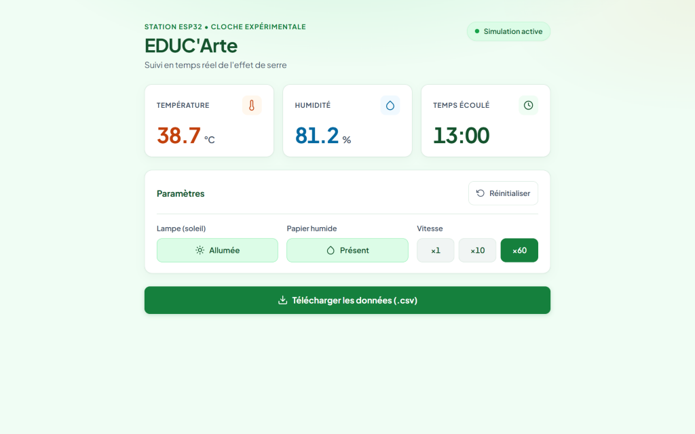

# EDUC'Arte — Simulation de l'effet de serre (ESP32 + DHT22)

Projet réalisé à l'origine en **Terminale** pour mesurer et visualiser l'effet de serre en temps réel à l'aide d'un microcontrôleur **ESP32** et d'un capteur de température et d'humidité (**DHT22 / DHT11**).

Ce dépôt contient à la fois :
- le **firmware ESP32** (Arduino C++) prêt à être flashé sur matériel réel ;
- un **serveur local Python** (sans aucune dépendance externe) qui émule l'API HTTP de l'ESP32 et simule physiquement l'expérience pour tester, visualiser et exporter les données sans posséder la carte.



---

## Principe de l'expérience

Le capteur de température et d'humidité est placé **sous une cloche transparente**, éclairée par une **lampe** (qui simule le rayonnement solaire), avec un **papier humide** déposé à l'intérieur :

```text
          [ Lampe / Soleil ]
               \  |  /
             .-~~~~~~~-.
            /           \
           |   [DHT22]   |   <-- Cloche transparente
           |  (ESP32)    |
           | [~~~~~~~~~] |   <-- Papier humide
           +-------------+
```

1. **Effet de serre thermique** : la lampe chauffe l'intérieur de la cloche, dont la paroi limite la convection et piège la chaleur (montée progressive vers un plateau thermique).
2. **Rôle de la vapeur d'eau** : le papier humide s'évapore sous l'effet de la chaleur, faisant grimper l'humidité relative jusqu'à approcher la saturation (puis condensation sur la paroi lors du refroidissement).
3. **Expérience témoin sans papier humide** : si l'on retire le papier humide alors que la lampe chauffe, la température augmente mais l'humidité relative *baisse* (un air plus chaud peut contenir davantage de vapeur d'eau à quantité d'eau constante).

---

## Lancer la simulation en local (sans ESP32)

### Prérequis
- **Python 3.10+** (aucune bibliothèque tierce à installer).

### Démarrage
```bash
python simulator/server.py
```

Puis ouvrez votre navigateur sur **[http://127.0.0.1:8000](http://127.0.0.1:8000)**.

Options utiles en ligne de commande :
```bash
# Démarrer directement en accéléré x10 sur le port 8080
python simulator/server.py --port 8080 --speed 10
```

Depuis l'interface web, vous pouvez :
- suivre la température (°C), l'humidité (%) et le temps écoulé en temps réel ;
- allumer ou éteindre la lampe, ajouter ou retirer le papier humide, accélérer le temps (`×1`, `×10`, `×60`) ou réinitialiser l'expérience ;
- cliquer sur **Télécharger les données (.csv)** à tout moment pour récupérer l'ensemble des mesures récoltées.

---

## Format des données exportées (CSV)

Le fichier téléchargé (`educarte_effet_de_serre.csv`) est directement exploitable dans Excel, LibreOffice Calc ou Python (`pandas`) :

```csv
timestamp,elapsed_s,temperature_c,humidity_pct,lamp_on,wet_paper
2026-11-21T14:50:00Z,0.0,21.0,48.1,1,1
2026-11-21T14:50:01Z,10.0,21.7,51.6,1,1
2026-11-21T14:50:02Z,20.0,22.4,55.2,1,1
```

---

## API HTTP (commune à l'ESP32 et au simulateur)

| Route | Méthode | Description |
| :--- | :---: | :--- |
| `/` | `GET` | Interface web temps réel |
| `/api/data` | `GET` | Dernière mesure (`temperature_c`, `humidity_pct`, `elapsed_s`, statut) |
| `/api/history` | `GET` | Historique complet des mesures en JSON |
| `/api/export.csv` | `GET` | Téléchargement de l'historique au format CSV |
| `/api/sim/config` | `POST` | *(Simulateur)* Met à jour `lamp_on`, `wet_paper`, `speed` (`1`, `10`, `60`) |
| `/api/sim/reset` | `POST` | *(Simulateur)* Réinitialise l'expérience à `t = 0` |

---

## Utilisation sur matériel réel (ESP32 + DHT22 / DHT11)

Le firmware se trouve dans [`firmware/esp32_greenhouse/esp32_greenhouse.ino`](firmware/esp32_greenhouse/esp32_greenhouse.ino).

### Câblage par défaut

| Broche capteur DHT | Broche ESP32 |
| :--- | :--- |
| `VCC` | `3.3V` |
| `GND` | `GND` |
| `DATA` | `GPIO 4` *(pull-up 10 kΩ vers 3.3V si capteur sans module)* |

### Flasher depuis l'IDE Arduino
1. Installez le support de cartes **ESP32** (Espressif) et les bibliothèques **DHT sensor library** + **Adafruit Unified Sensor**.
2. Ouvrez `firmware/esp32_greenhouse/esp32_greenhouse.ino`.
3. Renseignez `WIFI_SSID` et `WIFI_PASSWORD` (et ajustez `DHT_TYPE` en `DHT11` si besoin).
4. Téléversez sur l'ESP32, puis ouvrez le moniteur série (`115200 bauds`) pour lire l'adresse IP locale de la station.

---

## Structure du projet

```text
EDUC'Arte/
├── firmware/
│   └── esp32_greenhouse/
│       └── esp32_greenhouse.ino   # Code Arduino C++ pour ESP32 + DHT22/DHT11
├── simulator/
│   ├── __init__.py
│   ├── physics.py                 # Modèle physique (cloche, lampe, évaporation du papier humide)
│   └── server.py                  # Serveur HTTP local zéro dépendance
├── web/
│   ├── index.html                 # Interface web simple (mesures + paramètres + export CSV)
│   ├── style.css
│   └── app.js                     # Polling temps réel de l'API et commandes de simulation
├── screenshots/
│   ├── educarte-desktop.png       # Aperçu ordinateur
│   └── educarte-mobile.png        # Aperçu mobile
├── tests/
│   ├── test_physics.py            # Tests unitaires du modèle physique
│   └── test_server.py             # Tests d'intégration des routes HTTP
├── .gitignore
└── README.md
```

---

## Lancer les tests

```bash
python -m unittest discover -s tests -v
```
